# MiSTer Pat's GUI

A modern game launcher for the [MiSTer FPGA](https://github.com/MiSTer-devel/Main_MiSTer),
written in plain C++ for the device's own Linux side. It boots straight into a 1080p tiled
interface with box art, favourites and history — and hands control back to the MiSTer as soon
as you start a game.

It is not a core. Nothing about the FPGA changes. This is a frontend that picks a game and
asks the MiSTer to load it, the same way the stock menu does.

<!-- screenshots:start -->

| Home | Favorites |
| --- | --- |
| 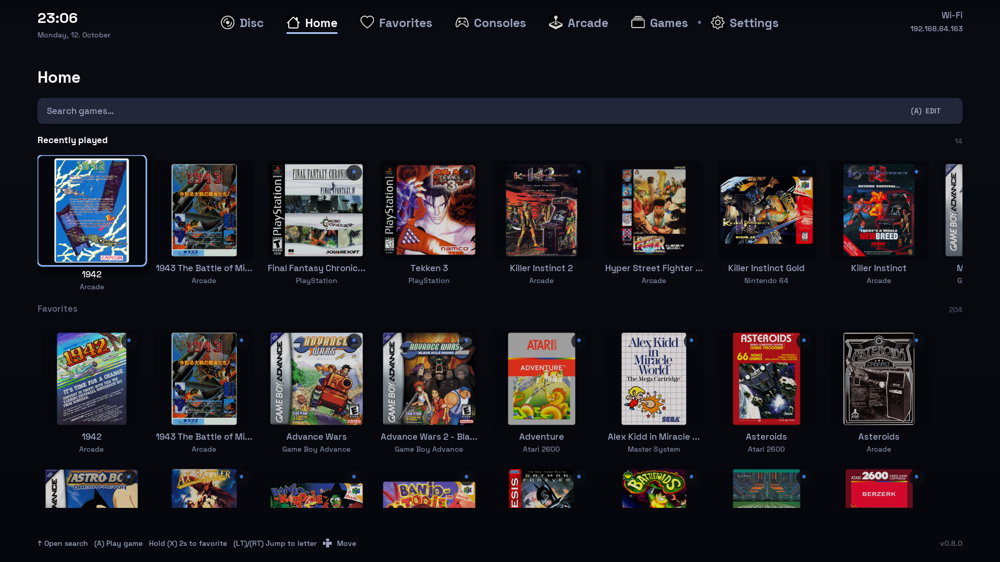 | 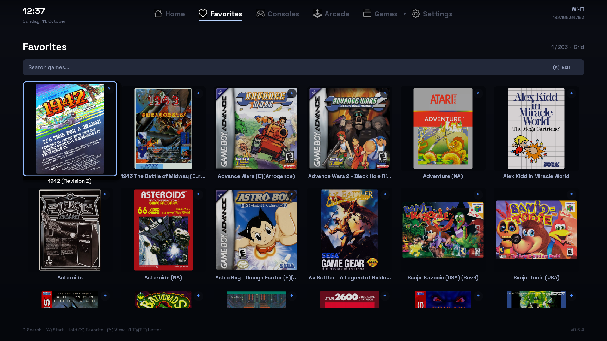 |

| Systems | Arcade |
| --- | --- |
| 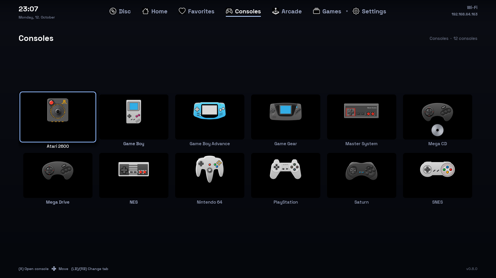 | 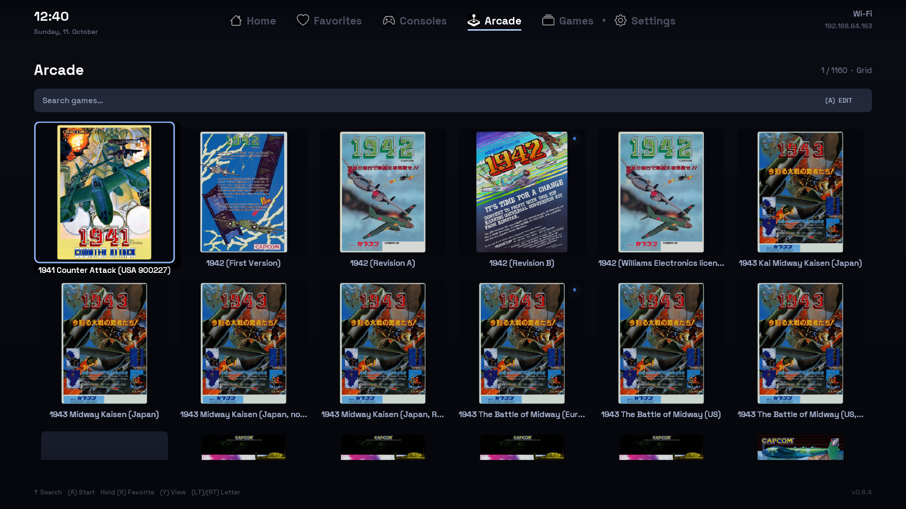 |

| Disc |
| --- |
| 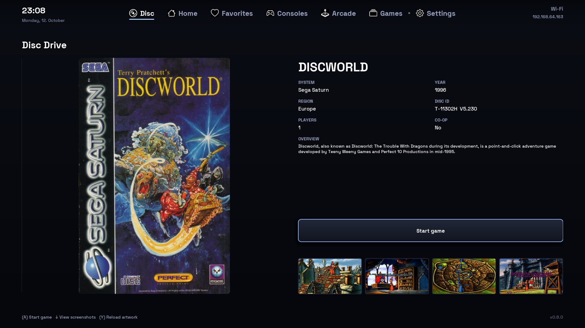 |

Every system's games in the presentation you prefer — Y cycles through them. Here, SNES in Grid, Boxart small and List:

| Grid | Boxart small |
| --- | --- |
| 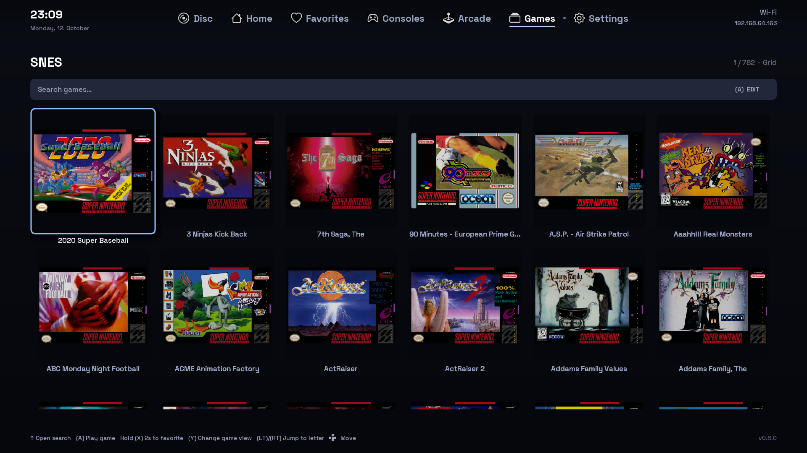 | 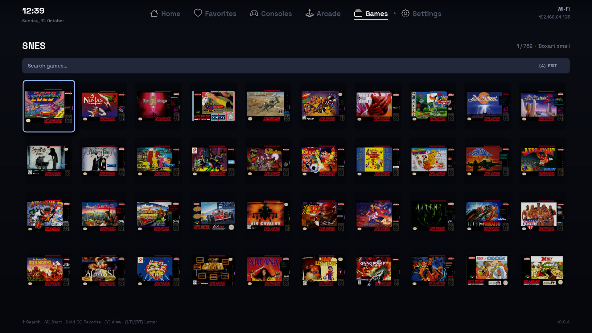 |

| List | Choose version |
| --- | --- |
| 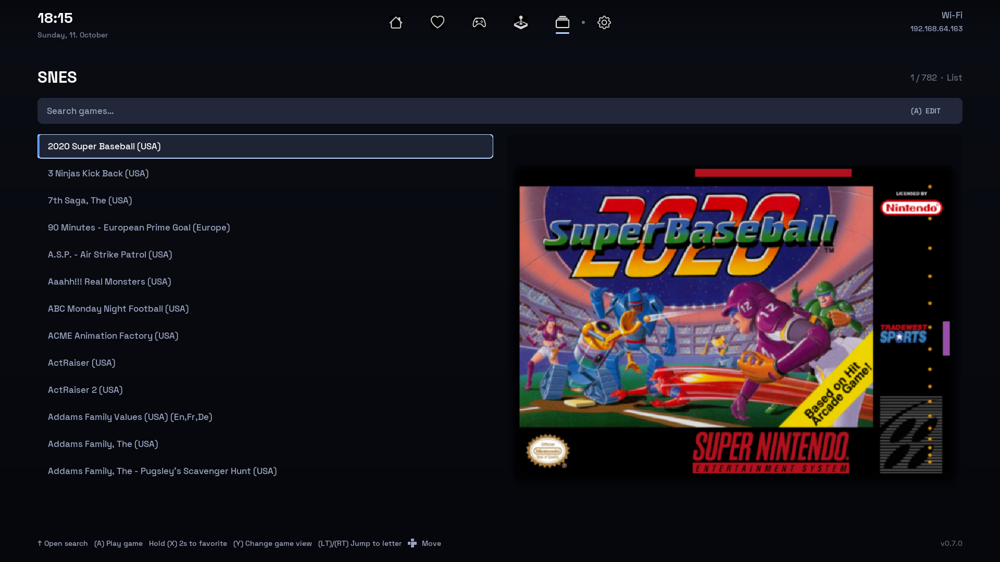 | 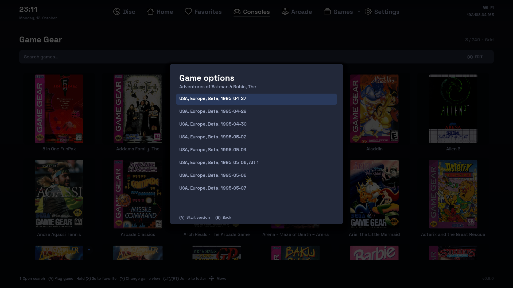 |

| Games |
| --- |
| 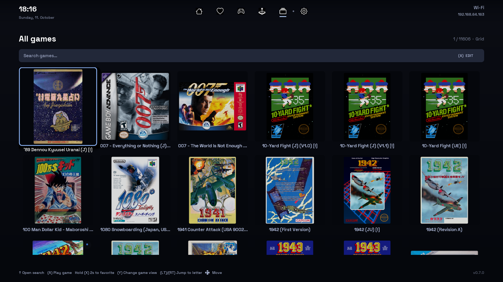 |

Settings, including Interface, Accessibility, System, the Changelog, the update page and controller input test:

| Settings | Interface settings |
| --- | --- |
| 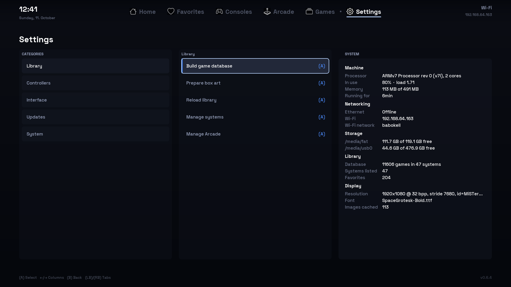 | 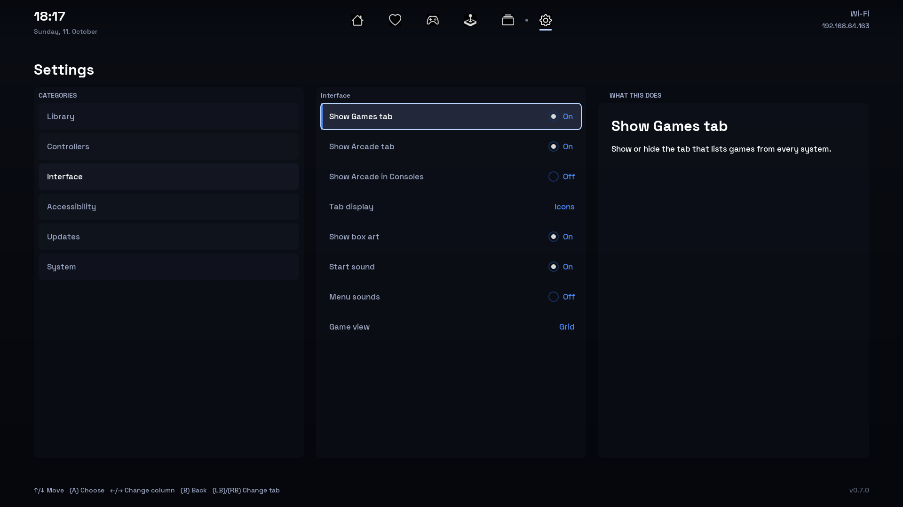 |

| Accessibility settings | System settings |
| --- | --- |
| 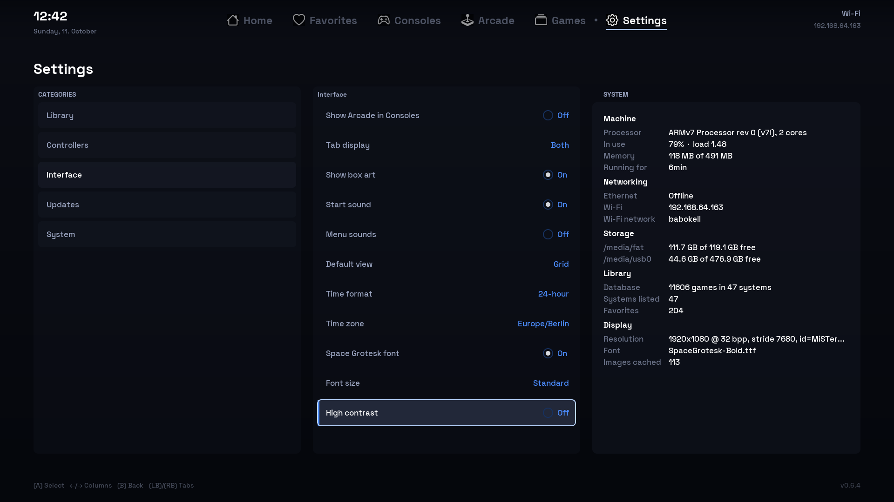 | 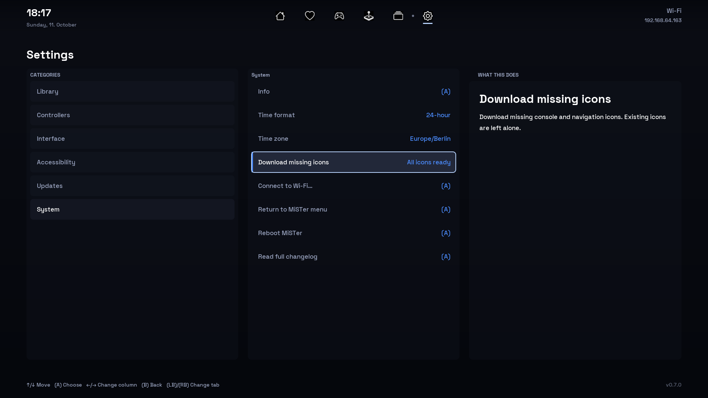 |

| Updates | Controller input test |
| --- | --- |
| 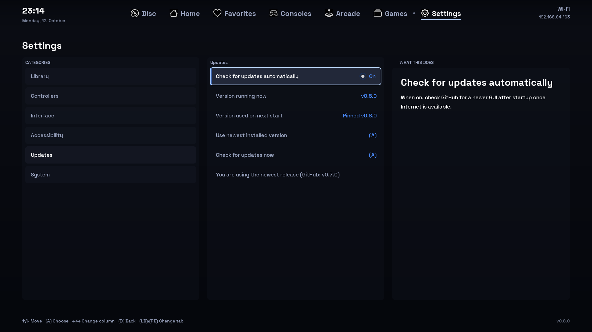 | 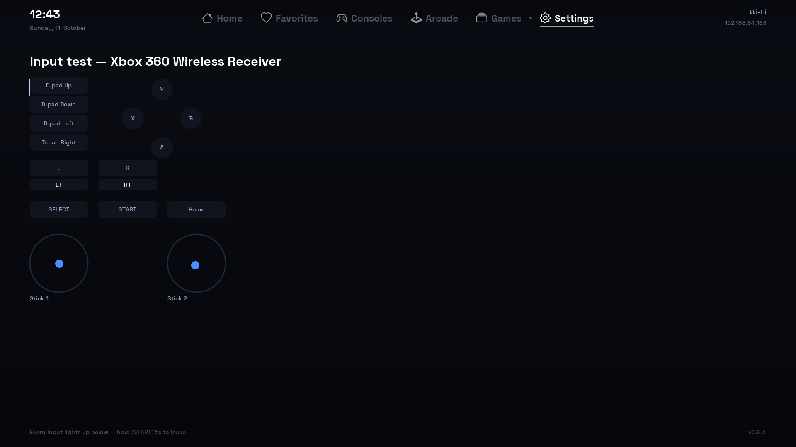 |

<!-- screenshots:end -->

## Why

The MiSTer's stock menu is a file browser. It is fast, precise and does exactly what it was
built to do — but it looks like a file browser, and on a television across a room it reads
like one too.

This project takes the other approach: box art first, a tile grid you can cross with a
D-pad, and the things you actually reach for — recently played, favourites — on the first
screen. It aims to look like a console's own dashboard rather than a directory listing.

The constraint that shapes everything: the DE10-Nano has two Cortex-A9 cores at 800 MHz and
**no GPU**. Every pixel is drawn by the CPU into a framebuffer. That rules out the usual
toolkits and rules in careful, measured software rendering — see
[PERFORMANCE.md](docs/PERFORMANCE.md) for what that costs and where the budget went.

## The premise: easy to use, easy to understand

Every decision is measured against one principle: **easy to use, easy to understand, and
accessible to anyone.** A controller should be enough to browse and launch games from the
couch, without a keyboard or a manual.

That means clear focus and button hints, predictable ordering, and visible counts when they
help explain what is on screen. Prefer the simpler behavior when two choices work equally well.
Setup should be straightforward too: Settings handles the Physical Disc package download and
checks whether compatible PlayStation or Saturn FPGA cores are installed.

## Features

- **Browse the library:** Home shows recently played games and favourites. Consoles opens each
  system's games, while Games provides one alphabetized list across the library. Hide systems or
  the Games tab when they are not useful.
- **Choose a game view:** use Grid, Boxart small or List, with a shared setting or a remembered
  view for each game area.
- **Find games quickly:** search within Home, Favorites, a console, Arcade or Games. L2/R2 jump
  between initial letters in large libraries.
- **Keep regional and language versions together:** choose a ROM version when needed; the last
  successfully started version is remembered.
- **Play Arcade games reliably:** check that the core, ROM and every required CRC are present;
  match artwork to the exact ROM revision and explain missing games in a diagnostic view.
- **Use physical discs:** the Disc tab identifies PlayStation and Saturn discs offline, shows
  cached or fetched artwork, and launches through the matching Physical-Disc MGL.
- **Prepare box art from Settings:** convert existing covers to view-sized images and fetch
  missing artwork from the libretro thumbnail server. Artwork loads in the background so menus
  remain responsive.
- **Browse large libraries without waiting:** the GUI builds its own per-system game index and
  fills long lists progressively, including the combined Games view.
- **Make the interface yours:** choose tab names or icons, larger text, larger button hints, and high contrast with a
  highlight color you pick (eight to choose from), and separate startup and menu sounds. Settings also includes clock and time-zone controls, Wi-Fi
  setup, asset downloads, artwork visibility and a confirmed reboot action.
- **Update safely:** check for releases, verify downloaded files, install a versioned GUI library
  and choose when to restart. Older installed versions remain available for recovery.
- **Boot straight into the GUI and launch through MiSTer's own loader.** The FPGA and its core
  loading remain unchanged. The interface is designed for 1080p; other output resolutions have
  not yet been verified.

## Requirements

- A MiSTer (Terasic DE10-Nano) with a working SD card setup
- SSH access to the device
- Your game library on the SD card or one or more USB volumes, wherever the MiSTer finds it

## Installation

See **[INSTALL.md](docs/INSTALL.md)** for the full procedure, including how to undo it.

In short: everything the GUI owns lives in one directory on the SD card,
`/media/fat/mister-pat`. Two lines in `MiSTer.ini` point the boot path at it. Nothing else on
the system is modified, and uninstalling means deleting that directory and those two lines.

## Building from source

For the toolchain, dependencies, build and deployment steps, see
[Building from source in INSTALL.md](docs/INSTALL.md#building-from-source).

## Controls

| Input | Action |
| --- | --- |
| D-pad / stick / arrow keys | Move |
| A / Enter | Open, or start the game |
| B / Escape | Back |
| Select | Open game actions: Start Game or Load box art for the selected game |
| X / F | Toggle favourite |
| Y / V | Cycle view |
| LB / RB, Page up/down, Tab | Switch tab |
| LT / RT (L2/R2), `,` / `.` | Jump to the previous/next initial letter |
| Menu button, long press | Leave a running game and return to the GUI |
| Q | Quit |

In Home, Games, Favorites, a system's game list or Arcade, press **Up** from the first game row to
focus its search field, then **A** to open the on-screen keyboard. While it is open, **B** cancels
the draft, **Y** inserts a space, **X** deletes the last character, and **Start** submits the
search. Select the on-screen Symbols key with **A** to switch layouts; Shift toggles letter case.
Search terms match the beginnings of words in game titles; Home, Games and Favorites also match
system names. All terms must match, in any order. Clear the field and submit to restore the full
current collection.

While the GUI is running, it grabs controller devices exclusively so button presses do not
also reach the terminal or MiSTer OSD. It releases them when the GUI exits or hands control to
a core, so core input works normally.

## Tested controllers

| Controller | Connection | Notes |
| --- | --- | --- |
| Xbox Series X pad | 8BitDo Adapter 2 | The daily driver used for most of this project's own development |
| Retro-Bit Sega Saturn pad | 2.4 GHz wireless adapter | D-pad only, no analogue stick. Works great once switched to X-Input mode — see the [pad's manual](https://retro-bit.com/sitepad-data/uploads/2025/07/NA-Saturn-Pro-2.4-GHz-Wireless-Controller_11-16-23.pdf) for the mode switch |
| Xbox 360 pad ×2 | Xbox 360 Wireless Receiver for Windows | Needs a `deadzone=` set to behave — see [CONTROLLER.md](docs/CONTROLLER.md#3-deadzone) — and [INSTALL.md](docs/INSTALL.md) for the vendor/product gotcha that surfaced along the way |
| PS4 controller (DualShock 4) | Wired (USB cable), and Bluetooth | Bluetooth pairing survives a reboot — the pad reconnects on its own, no re-pairing needed |
| 8BitDo Arcade Stick (Xbox version) | 2.4 GHz wireless dongle, and wired (USB cable) | Works flawlessly over both, no extra setup needed |

Still to try: PS5 (DualSense) and the Saturn pad wired. See [CONTROLLER.md](docs/CONTROLLER.md) for
the controller-management feature this is building towards.

## Configuration

| File | Purpose |
| --- | --- |
| `/media/fat/mister-pat/favorites.txt` | Favourites, one per line |
| `/media/fat/mister-pat/history.txt` | Recently played |
| `/media/fat/mister-pat/hidden-systems.txt` | Consoles hidden from the Consoles tab, one per line — see *Manage systems* in Settings |
| `/media/fat/mister-pat/preferences.txt` | Interface options, including sound, tab visibility, time settings and saved game views |
| `/media/fat/mister-pat/systems.conf` | Per-system loader slot overrides, see [the example](assets/systems.conf.example) |
| `/media/fat/mister-pat/icons/` | Console icons |
| `/media/fat/mister-pat/gamesdb/` | The game database: `catalog.tsv`, `roots.tsv` and one `<System>.tsv` per system |
| `/media/fat/mister-pat/logs/crash.log` | Fatal error details, when a crash log could be written |

The GUI also takes command-line options, which is how every screen can be reached and
captured without a controller:

```
--tab home|favorites|systems|arcade|games|settings  screen to open
--view list|grid|small                  game presentation
--system NAME                            preselect a system
--frames N                               render N frames, then exit
--dump PATH                              write the finished canvas to PATH
--press LIST                             feed button presses first, e.g. down,select,confirm
--launch-now                             start the preselected game at once
--dry-run                                print the MGL instead of loading it
--no-wizard                              never open the database wizard
--scan                                   build the game database and exit
--no-input                               do not open the input devices
--exclusive                              grab inputs exclusively (default)
--stats                                  report where frame time is spent
--full-redraw                            repaint everything every frame
--no-splash                              skip the startup splash
--splash-ms N                            set its initial wait in ms (default 1000)
```

## Repository layout

```
src/              the GUI, one class per file
tests/            host-side checks (damage tracking, letter jump, game database)
tools/            deploy, screenshot and run helpers
docs/             installation, design and performance documentation
assets/           console icons, example configuration
patches/          the patch that makes the MiSTer main binary start this GUI
poc/              the standalone experiments the design was proven with
third_party/      dependency sources; Main_MiSTer is cloned here when building
```

## Documentation

| Document | What it covers |
| --- | --- |
| [INSTALL.md](docs/INSTALL.md) | Installing, verifying and uninstalling |
| [DESIGN.md](docs/DESIGN.md) | The shared design system: sizes, spacing, colors, box-art sizes, controls, dialogs and states |
| [GUI.md](docs/GUI.md) | The interface design: layout, tiles, navigation, typography |
| [PERFORMANCE.md](docs/PERFORMANCE.md) | What was measured, what it cost, and what made it fast |
| [BOXART.md](docs/BOXART.md) | Artwork preparation, formats and scraper matching audit |
| [WIFI.md](docs/WIFI.md) | Wi-Fi setup behavior and MiSTer configuration notes |
| [POC.md](docs/POC.md) | How the MiSTer boots, where a frontend hooks in, and what was proven on hardware |
| [CONTROLLER.md](docs/CONTROLLER.md) | Controller-first setup — listing pads, an input test, deadzone, button mapping and Bluetooth pairing: the design, and what real hardware testing found along the way |
| [ARCADE.md](docs/ARCADE.md) | Arcade support — the analysis, the design and what was built from it. The MRA format, a ROM-storage-priority bug found on real hardware, how the library, the tab and the box art work, and what is still open |
| [GAME-VERSIONS.md](docs/GAME-VERSIONS.md) | Game version grouping behavior and safeguards for future parser changes |
| [DISCDRIVE.md](docs/DISCDRIVE.md) | Physical PlayStation and Saturn disc detection, artwork lookup, safe MGL launch and remaining hardware acceptance |
| [THEGAMEDB.md](docs/THEGAMEDB.md) | TheGamesDB API experiments, region/platform matches, screenshot coverage and scraper behavior |
| [ISSUES.md](docs/ISSUES.md) | Known issues and open investigations, with the evidence collected so far |

## Status

Working: booting into the GUI, browsing every system, box art, favourites, history, letter
navigation, launching games, returning from a game with a long press on the menu button, and
hiding systems or the Games tab from Settings for a large library. The 0.6 series adds controller-
operated search, clock and time-zone settings, Wi-Fi setup, interface sound controls, per-game
artwork actions, a confirmed system reboot action, and selectable face-button labels. Version
0.6.3 extended the existing three-phase boxart reveal to Home's recent and favorite covers and
fixed repeated fallback reloads. Version 0.6.4 adds a fading tab underline, selectable tab icons,
a unified asset download action, clearer toggle indicators, and the Consoles tab changes. Version
0.6.5 adds accessibility controls, a GitHub changelog viewer, explanations for settings and
clearer library and cover-art progress messages, the revised Settings layout and a Wi-Fi
activation fix. Version 0.7.0 adds a shared or individually remembered game view for Home,
Favorites, console game lists and Games. It also simplifies the List view's artwork panel,
shows each favorite's system, and avoids repainting unchanged list content. Version 0.8.0 adds
regional and language game-version grouping, physical PlayStation and Saturn disc detection and
launch, offline disc-title lookup, TheGamesDB artwork with Libretro fallback, local caching, and
a per-disc artwork reload action. Hardware acceptance details and current scraper limitations are
documented with the feature notes.
Version 0.8.2 adds a faster box-art path (a directory index, border-only cover focus that moves
instantly), larger text, a high-contrast highlight color and button-hint size, and a shared design
system.
See
[CHANGELOG.md](CHANGELOG.md),
[GUI.md](docs/GUI.md), [BOXART.md](docs/BOXART.md), [DISCDRIVE.md](docs/DISCDRIVE.md), and
[THEGAMEDB.md](docs/THEGAMEDB.md).

## Roadmap

**This roadmap is not set in stone.** It is a statement of intent, not a promise: what goes
into which release, and in what order, will move as testing on real hardware shows what matters
most, and a version's scope can shrink, grow or change places with another. Nothing here is
dated. Only the next release is planned with any precision, and even that gets sharper once its
testing has been done — the later ones are direction.

### Release plan

Releases are themed rather than feature-by-feature, so that each one has a single thing it is
for.

#### 0.3.0 — Tests and bug fixes

- [x] **Test the Arcade library, tab, and updated scraper on real hardware.**
- [x] **Improve box art matching** using the real scrape-miss list and an audit of Libretro's
      index. See [BOXART.md](docs/BOXART.md) for results and the limits of the available counts.
- [x] **Font fallback and interface fixes** — test without external TrueType fonts, tune fallback sizing,
      improve spacing, and show Ethernet and Wi-Fi addresses in Settings.
- [x] **Navigation and input fixes** — alphabetize Arcade group previews and require a
      two-second hold to change a favorite.

See [CHANGELOG.md](CHANGELOG.md) for the complete 0.3.0 change list.

#### 0.4.0 — Optimisation

- [x] **Smoother, faster menu control**, everywhere. Confirmed by user testing on the MiSTer.
- [x] **View-sized artwork files and bounded background decoding.** Prepare box art creates
      five BMP sizes with JPEG/PNG fallback; cover decoding runs in a bounded worker queue.
      See [CHANGELOG.md](CHANGELOG.md) for the release details.
- [x] **Optional box art and faster icon startup.** Settings can hide artwork; the one-second
      splash then loads system icons sequentially, preferring native-size BMPs.
- [x] **A much shorter first visit to Systems.** The game database already records which
      systems have games, so the tab can show its grid without building that answer on entry.

#### 0.5.0 — Install and update flow

- [x] **A dependable first-install flow.** The setup script installs the loader, the GUI
      library, fonts and system icons, and prints the needed `MiSTer.ini` changes.
- [x] **An in-GUI update flow.** The opt-in GitHub check stays; *Check now* and *Update now*
      install a verified GUI library, followed by a MiSTer restart. An optional symlink can
      select an older installed version.
- [x] **A stable, minimal GUI loader.** The existing `gui=` path stays and loads the active,
      versioned GUI library; older versions are retained for recovery.

See [CHANGELOG.md](CHANGELOG.md) for the complete 0.5.0 change list.

#### 0.6.0 — Wi-Fi, sound and settings

- [x] **Wi-Fi setup from Settings**, including network selection and credentials. Settings →
      System groups the connected network name beside its Wi-Fi address. The complete flow was
      tested on MiSTer hardware; setup notes are in [WIFI.md](docs/WIFI.md).
- [x] **Search** — search games with the shared on-screen keyboard, then browse, start, and
      favorite matches in the regular grid.
- [x] **Settings** — clock format and time zone, Space Grotesk control, per-game artwork actions,
      and a confirmed system reboot.
- [x] **Interface sounds** after the splash screen, while moving through the GUI, when
      switching tabs and when starting a game. Settings → Interface can disable the startup
      sound and menu sounds independently; menu sounds include navigation, tab changes, and game
      launches.

#### 0.7.0 — Usability

- [x] **Simplify the Arcade tab:** remove the Manufacturers and Categories entry points and show
      Arcade games directly in the configured standard Games view.
- [x] **Improve help and status text** with clearer explanations for settings and updated hints
      in views, including library loading and box-art scraping.
- [x] **Show a checkbox alongside “On” or “Off”** for toggle settings, with fixed-width values.
- [x] **Face button style** setting with XBOX, PlayStation and Nintendo labels. Confirm stays on
      the bottom face button and Back on the right; swapping them remains a separate backlog item.
- [x] **Add tab icons** with options to show tab names, tab icons or both; download missing BMPs
      through Settings → System → Download Assets or during a GUI update.
- [x] **Rename the Systems tab to Consoles** and add a “Show Arcade in Consoles” option,
      off by default.
- [x] **Add a search bar to relevant tabs** and search within the current context: all games in
      Home and Games, favorites in Favorites, the selected system in its game list, and Arcade
      games in Arcade. Remove the Search tab; Settings has no search.
- [x] **A separately remembered view per tab** — Home, Favorites, Consoles and Games — instead
      of the one default view for all of them.

#### 0.8.0 — Game variants and SuperStation Dock

- [x] **Group language and revision variants of one game.** Show one entry for titles such as
      Pokémon Sapphire even when the library has separate Europe, Japan and USA ROMs or
      multiple revisions; let the player choose a specific version when needed. Keep the ROMs
      and their language/revision details intact.
- [x] **Disc-drive support for the SuperStation Dock.** Detect physical PlayStation and Saturn
      discs, resolve their title offline, show cached or scraped artwork, and launch through the
      matching physical-disc MGL. This release uses manual launch; automatic launch and other CD
      systems remain future work. Physical-disc Main selection stays scoped to those MGLs, not the
      global MiSTer Main setting. Broader Dock acceptance remains tracked in
      [DISCDRIVE.md](docs/DISCDRIVE.md). Parser safeguards are in
      [GAME-VERSIONS.md](docs/GAME-VERSIONS.md).

#### 0.8.2 — Speed, accessibility and a shared design (current)

- [x] **Faster box art.** A directory index avoids slow lookups in huge media folders; a
      focused cover only gets a border and focus moves instantly. See [BOXART.md](docs/BOXART.md).
- [x] **Accessibility.** Larger text, a High contrast color of your choice and a button-hint size
      setting.
- [x] **A shared design system** in [DESIGN.md](docs/DESIGN.md) and a place for open problems in
      [ISSUES.md](docs/ISSUES.md).

#### Backlog

- [ ] **Option to swap Confirm and Back buttons**, with the current European mapping as the
      default.
- [ ] **Fade in tab content when switching tabs** instead of sliding it into view.
- [ ] **Choose the order of consoles** in the Consoles tab. Hiding unused consoles already works.
- [ ] **Boxart scraping using TheGamesDB**, with a list of titles that have no match and the
      option to retry artwork lookup for one title or all unmatched titles.
- [ ] **Use `update_all.sh` from the GUI**, showing the installed version, what will be updated
      and whether a restart is needed.
- [ ] **Back up and restore settings.** Export favorites, hidden systems, per-tab views and GUI
      settings, and restore them after a reinstall.
- [ ] **Screensaver and screen dimming after inactivity.** Dim the display after a period
      without input and activate a screensaver after a longer idle period.
- [ ] **Localisation.** Everything is English today, with the strings still inline; extracting
      them is the prerequisite.
- [ ] **Loader slots for the remaining CD-based cores** (CD-i, Jaguar CD).
- [ ] **Telling two identical controllers apart**, with separate mappings for each (MiSTer's own
      `controller_unique_mapping`). Left out of the first pass of controller management on
      purpose — two same-model pads sharing one mapping is the common case.
- [ ] **Per-game DIP-switch editing** for Arcade.
- [ ] **Manage Cores / Manage MRAs** for Arcade, syncing against the official distribution
      manifest. Design in [ARCADE.md](docs/ARCADE.md#decision-manage-cores-and-manage-mras).
- [ ] **Video modes.** `video_mode=` in `MiSTer.ini`, including a clean fallback when a
      configured mode fails or is not available. Also covers running, and verifying, this GUI
      at resolutions other than 1080p — it only scales its own design pixels to whatever the
      framebuffer reports, which is untested outside 1080p despite "scales from 480p to 4K"
      being listed as a feature.
- [ ] **Testing more controllers.** See [Tested controllers](#tested-controllers) for what has
      been confirmed so far and what is still to try.
- [ ] **Telling HDD/CHD-based Arcade games apart** — boards such as Killer Instinct — from those
      that start unattended. Nothing found can automate the one-time manual step itself; see
      [ARCADE.md](docs/ARCADE.md#hddchd-based-games-no-automated-mount-found).
- [ ] **A web interface for managing the library** from a computer or phone, rather than with
      a game pad: everything under *Library management* above, plus a better search, uploading
      new games to the MiSTer, deleting and renaming them, managing box art, and editing
      favourites.

## Acknowledgements

- [Main_MiSTer](https://github.com/MiSTer-devel/Main_MiSTer) — the MiSTer main binary, which
  this project forks for its boot path and relies on for core loading
- [Console Mode](https://github.com/Retro-Remake/ConsoleMode_Distribution) by Retro Remake —
  whose library cache the GUI currently reads, and whose approach to being gentle with the
  drive it learned from
- [retro-game-console-icons](https://github.com/KyleBing/retro-game-console-icons) — the
  console icon set

## A note on how this was built

This project was built with the help of AI.

I want to be honest about that: without it, this project would not have grown from a proof
of concept into something that actually works — a project genuinely capable of replacing the
official Console Mode. Between the lack of documentation and the fact that Console Mode's own
source is no longer publicly available, reaching this point without that help would have
taken several months, if not years.

At the same time, I want to be just as clear that AI alone would not have gotten here either.
A lot of hard, careful work went into this project — done by a person. Me.

## Disclaimer

This is an independent, unofficial hobby project, provided "as is" and without warranty of
any kind, express or implied — including, without limitation, warranties of merchantability,
fitness for a particular purpose, and non-infringement. Use it entirely at your own risk. To
the extent permitted by law, the author accepts no liability for any damage or loss arising
from its use, including but not limited to a corrupted SD card, a bricked device, lost save
data, or any other harm to your hardware or data.

The installer modifies boot-time files on your MiSTer's SD card and replaces the main binary.
Care has been taken to make that reversible — see [INSTALL.md](docs/INSTALL.md) — but as with any
change to a device's boot path, something going wrong is always possible.

This project does not provide, host, link to, or in any way distribute copyrighted game ROMs,
BIOS files, or other game data. It only launches files already present on your own storage,
exactly as the MiSTer's own menu does. You are solely responsible for ensuring you are legally
entitled to any game files you use with it.

This project is not affiliated with, endorsed by, or sponsored by the MiSTer FPGA project,
Terasic, Retro Remake, or any console manufacturer. "MiSTer" and any console, system or
company names referenced or depicted in this project — including in its bundled console icon
set — are the trademarks of their respective owners and are used here only to describe
compatibility, not to claim any association with them.

## License

GPL-3.0. The project builds on Main_MiSTer and bundles the console icon set, both GPL-3.0,
so it is GPL-3.0 throughout. See [LICENSE](LICENSE) for the terms and [NOTICE](NOTICE) for
what came from where.
